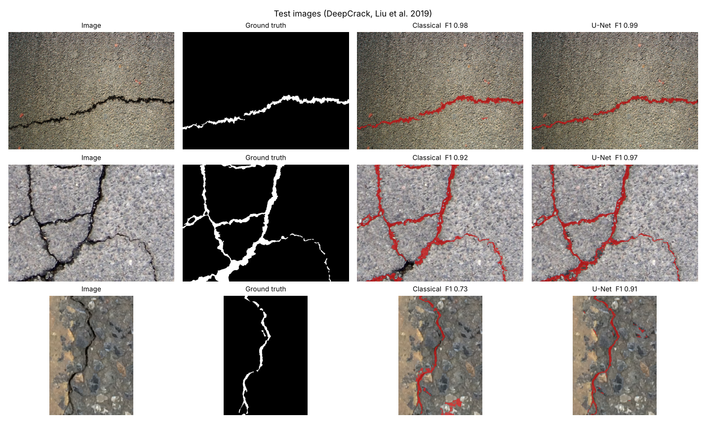
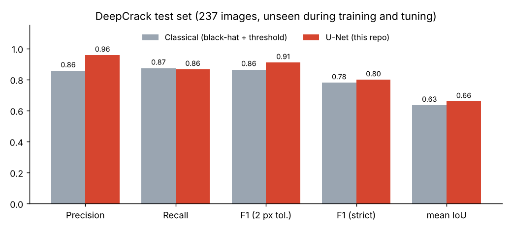
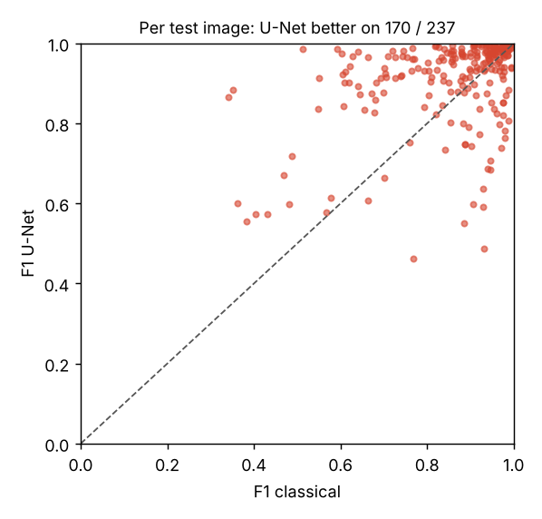
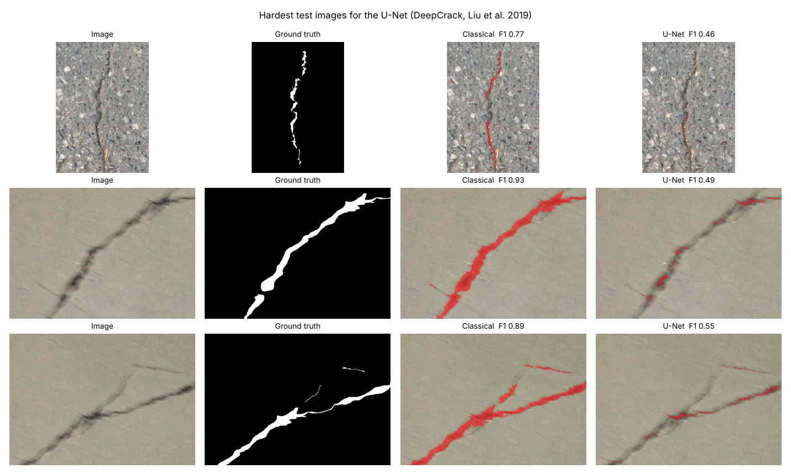

# Crack Segmentation: U-Net vs. Classical Image Processing

**A deep-learning crack detector (PyTorch U-Net), trained on real photos and compared fairly with a tuned classical pipeline on 237 unseen test images.**



**Skills shown:** PyTorch · U-Net architecture · data augmentation · loss design for imbalanced data · training pipeline with model selection and threshold tuning on held-out data · evaluation metrics for thin structures · fair baselines · failure analysis · GPU training notebook (Colab) · Gradio web app

---

## Results

| DeepCrack test set (237 images) | Precision | Recall | **F1 (2 px tolerance)** | F1 (strict) | mean IoU |
|---|---|---|---|---|---|
| Classical: black-hat + threshold (tuned) | 0.86 | 0.87 | 0.86 | 0.78 | 0.63 |
| **U-Net (this repo)** | **0.96** | 0.86 | **0.91** | **0.80** | **0.66** |



* The U-Net is better on **170 of 237** test images. Its main gain is **precision**: it marks far fewer stains, joints and textures as cracks.
* Neither method saw the test images. The U-Net was trained on 260 training images. Its epoch and decision threshold were chosen on 40 held-out validation images. The classical parameters were tuned on training images only.
* **Fair comparison:** the classical baseline is not a straw man. Its parameters were searched with the same F1 metric. When the best value was at the edge of the grid, the search continued until the score stopped improving. This raised its F1 on the training images from 0.77 to 0.84.



### Where the U-Net fails



The hardest test images for the U-Net are **very wide, blurry cracks**. The model marks only their dark core, while the annotation covers the whole crack. The classical filter handles these better, because its kernel is very large. Likely causes and next steps:

- training crops of 256 px with few wide cracks → add more wide-crack crops or train at several scales
- a high decision threshold (0.88) that favours precision → choose it per crack width, or optimise IoU instead
- a small model (1.9 M parameters) trained on CPU for only 19 epochs → longer GPU training (see the notebook)

## How it works

| Part | Choice | Why |
|---|---|---|
| Data | [DeepCrack](https://github.com/yhlleo/DeepCrack): 537 RGB photos of concrete and asphalt cracks with hand-drawn masks (300 train / 237 test). 40 training images are held out for validation | public, with an official train/test split |
| Model | **U-Net**, 4 levels, BatchNorm, 1.9 M parameters ([`model.py`](model.py)) | strong for thin structures, and small enough to train on a CPU |
| Augmentation | random 256 px crops (preferring crops that contain cracks), flips, 90° rotations, brightness / contrast / colour jitter, blur and noise ([`data.py`](data.py)) | only 260 training images |
| Loss | **weighted BCE + soft Dice** | cracks are only ~3 % of the pixels |
| Training | AdamW + one-cycle learning rate. Every epoch is evaluated on the validation images, and the best epoch is kept ([`train.py`](train.py)) | no test data is used for any decision |
| Threshold | chosen on the validation images ([`tune_threshold.py`](tune_threshold.py)) | the 0.5 default is not optimal for imbalanced data |
| Metrics | precision / recall / **F1 with 2 px tolerance**, strict F1, IoU, pooled over all pixels ([`metrics.py`](metrics.py)) | hand annotation of thin cracks is not pixel-exact; the tolerance is the usual crack-detection metric |
| Baseline | CLAHE → Gaussian → **black-hat** → threshold (mean + k·std) → removal of small and round blobs ([`classical.py`](classical.py)) | strong, commonly used classical approach |
| Inference | any image size: padding to a multiple of 16, tiling for large images ([`predict.py`](predict.py)) | real photos are larger than the training crops |

The model in [`weights/`](weights) was trained for 19 epochs on a 2-core CPU, without a GPU (about 55 min). The best validation F1 is **0.87** at epoch 15 ([`results/training_log.csv`](results/training_log.csv)).

## Usage

```bash
pip install -r requirements.txt

python app.py                          # web app: upload a photo, compare U-Net and classical
python predict.py photo.jpg            # writes photo_crack_mask.png and photo_crack_overlay.png
python evaluate.py                     # downloads DeepCrack, test-set metrics and figures
python train.py --epochs 40            # train on CPU (about 3 min per epoch)
python tune_classical.py               # re-tune the classical baseline (about 40 min)
```

**GPU training:** open [`train_colab.ipynb`](train_colab.ipynb) in Google Colab, choose a T4 GPU and run all cells. It trains a larger U-Net (`--base 32`, 80 epochs), evaluates it and downloads the weights.

**Live demo on Hugging Face Spaces:** create a new Space (SDK: Gradio, free CPU) and upload `app.py`, `predict.py`, `model.py`, `classical.py`, `metrics.py`, `requirements.txt`, `weights/unet.pt` and `results/classical_params.json`.

## Project structure

```
deep-learning-crack-segmentation/
├── data.py              # DeepCrack download, loading, train/validation split, augmentation
├── model.py             # U-Net and loss
├── metrics.py           # tolerance F1, strict F1, IoU
├── classical.py         # classical baseline and grid search
├── tune_classical.py    # baseline tuning on training images (grid + local refinement)
├── train.py             # training with model selection on validation images
├── tune_threshold.py    # decision threshold on validation images
├── evaluate.py          # test-set comparison and figures
├── predict.py           # inference on any image (tiling)
├── app.py               # Gradio web app
├── train_colab.ipynb    # GPU training on Google Colab
├── weights/unet.pt      # trained model (7.8 MB)
├── results/             # baseline parameters, training log, test metrics
└── images/              # README figures
```

## Data and licence

The **code** is MIT licensed ([LICENSE](LICENSE)). The **DeepCrack images are not included** in this repository. `data.py` downloads them from the authors' repository. Their use is restricted to **non-commercial research and education**. The example figures above show a few test images for illustration, with credit to the authors.

> Y. Liu, J. Yao, X. Lu, R. Xie, L. Li. *DeepCrack: A deep hierarchical feature learning architecture for crack segmentation.* Neurocomputing 338 (2019) 139–153. doi:10.1016/j.neucom.2019.01.036
